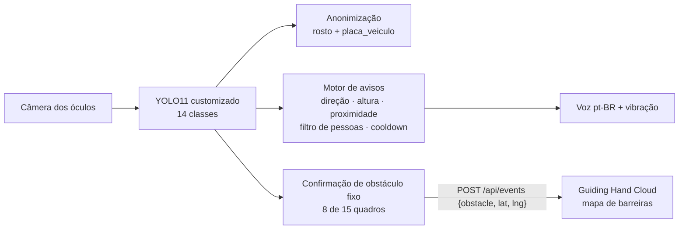

# Guiding Hand · Visão Computacional

Componente de **Visão** do Guiding Hand, projeto do desafio **CitizenTech** (FIAP · Global Solution 2026.2 · Engenharia de Software 4º ano), disciplina **Applied Computer Vision**.

O Guiding Hand é um par de óculos inteligentes que ajuda pessoas cegas ou com baixa visão a andar pela cidade com mais segurança. Este repositório tem o modelo de **detecção de objetos em tempo real** que reconhece obstáculos de calçada e o código que transforma essas detecções em avisos curtos de voz, como *"placa na altura da cabeça, à frente"*.

## 👥 Integrantes

- João Rodrigo Solano Nogueira, RM 551319
- Julia Amorim Bezerra, RM 99609
- Lana Giulia Auada Leite, RM 551143
- Tony Willian da Silva Segalin, RM 550667

## O que este componente faz

1. **Detecta 14 classes** com um **YOLO11 treinado sob medida** (transfer learning a partir dos pesos COCO):
   - **Obstáculos:** `carro`, `moto`, `bicicleta`, `poste`, `placa`, `arvore` (árvore/galho), `lixeira`, `banco`, `hidrante`, `escada` e `buraco`.
   - **Para o filtro de avisos:** `pessoa`.
   - **Para anonimização (LGPD):** `rosto` e `placa_veiculo`.
2. **Gera um único aviso por vez**, priorizando o que está perto, no caminho e **na altura da cabeça**, que é justamente o que a bengala não alcança.
3. **Evita excesso de avisos:** pessoas andando longe não geram aviso, e o mesmo obstáculo não é repetido em seguida.
4. **Borra rostos e placas de veículos** antes de qualquer exibição ou gravação.
5. **Confirma obstáculos fixos** (precisam aparecer em vários quadros seguidos) e envia só o tipo e a posição aproximada para o mapa de barreiras do [Guiding Hand Cloud](https://github.com/joaos-2/guiding-hand-cloud), em `POST /api/events`. Nenhuma imagem sai do dispositivo.



## Estrutura

```
configs/classes.yaml        classes, papel de cada uma e mapeamento Open Images / API
scripts/01_download_openimages.py   recorte do Open Images V7 (caixas, formato YOLO)
scripts/02_download_potholes.py     datasets abertos de buracos
scripts/03_build_dataset.py         junta as fontes e separa treino/validação/teste
scripts/04_train.py                 treino customizado do YOLO11
scripts/05_evaluate.py              métricas no teste, velocidade e figuras
scripts/blur_faces_plates.py        anonimiza fotos da equipe antes de entrarem no dataset
guiding_vision/                     detector, motor de avisos, privacidade, voz, cliente da API
demo.py                             demonstração em tempo real (webcam, vídeo ou imagens)
tests/                              testes da lógica de avisos
models/guiding_hand_yolo11.pt       modelo treinado
```

## Como rodar

Pré-requisitos: Python 3.12. O treino usa GPU NVIDIA (CUDA) ou Apple Silicon (MPS); a demo também roda na CPU.

```bash
python3.12 -m venv .venv && source .venv/bin/activate
pip install -r requirements.txt
```

**Só a demo (usa o modelo já treinado):**

```bash
python demo.py                         # webcam
python demo.py --source video.mp4 --save out/demo.mp4
python demo.py --api http://localhost  # envia barreiras ao Guiding Hand Cloud rodando localmente
```

**Reproduzir o dataset e o treino:**

```bash
python scripts/01_download_openimages.py   # ~8 mil imagens; filtra o CSV de treino (2,3 GB) em streaming
python scripts/02_download_potholes.py
python scripts/03_build_dataset.py
python scripts/04_train.py
python scripts/05_evaluate.py
pytest -q
```

**Treinar na nuvem (GPU grátis no Kaggle):** importe [notebooks/treino_kaggle.ipynb](notebooks/treino_kaggle.ipynb) no Kaggle, ative *Accelerator: GPU T4* e *Internet* e use *Save & Run All*. O notebook baixa os dados, treina, avalia e gera `resultados.zip` na aba *Output*.

**Fotos de calçadas de SP tiradas pela equipe (opcional):**

```bash
python scripts/blur_faces_plates.py fotos_originais/ data/raw/own/images   # anonimiza primeiro
# anote data/raw/own/images (CVAT, Label Studio ou makesense.ai), exporte em YOLO para data/raw/own/labels
python scripts/03_build_dataset.py   # metade vai para o treino e metade para o teste "mundo real" (test_sp)
```

## Resultados

YOLO11s, imagens de 640 px, treinado no Kaggle (2× T4). O early stopping (paciência de 15) parou o treino na época 60, e o melhor checkpoint é o da época 45. Números no conjunto de teste (894 imagens que o modelo nunca viu):

| mAP50 | mAP50-95 | Precisão | Recall | GPU T4 | CPU |
|---|---|---|---|---|---|
| **0,619** | **0,390** | 0,680 | 0,583 | 12,8 ms/img | 126,7 ms/img |

- **Melhores classes:** hidrante (0,96), lixeira (0,79), moto (0,77) e placa_veiculo (0,67).
- **Classes mais difíceis:** poste (0,28) e árvore/galho (0,39). São objetos finos ou de contorno vago, anotados de forma inconsistente no Open Images.

`python scripts/05_evaluate.py` gera as métricas por classe, as curvas, a matriz de confusão e uma grade de exemplos.

## Dados e licenças

| Fonte | Uso | Licença |
|---|---|---|
| [Open Images V7](https://storage.googleapis.com/openimages/web/index.html) (Google) | 13 classes, recorte balanceado | anotações CC BY 4.0; imagens CC BY 2.0 |
| [rupesh002/pothole-detection-dataset](https://huggingface.co/datasets/rupesh002/pothole-detection-dataset) | buracos | MIT |
| [Ryukijano/Pothole-detection-Yolov8](https://huggingface.co/datasets/Ryukijano/Pothole-detection-Yolov8) (Roboflow *potholes-detection-d4rma*) | buracos | CC BY 4.0 |

As imagens não são versionadas no repositório (`data/` está no `.gitignore`); os scripts baixam tudo de novo.
